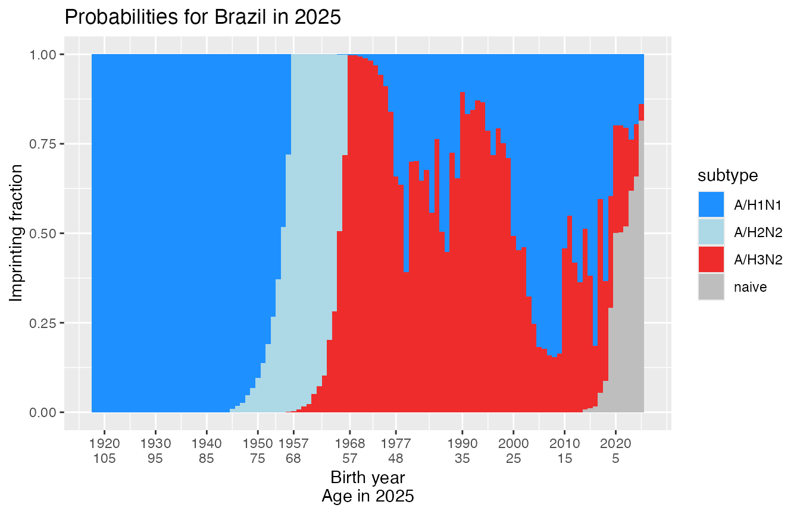
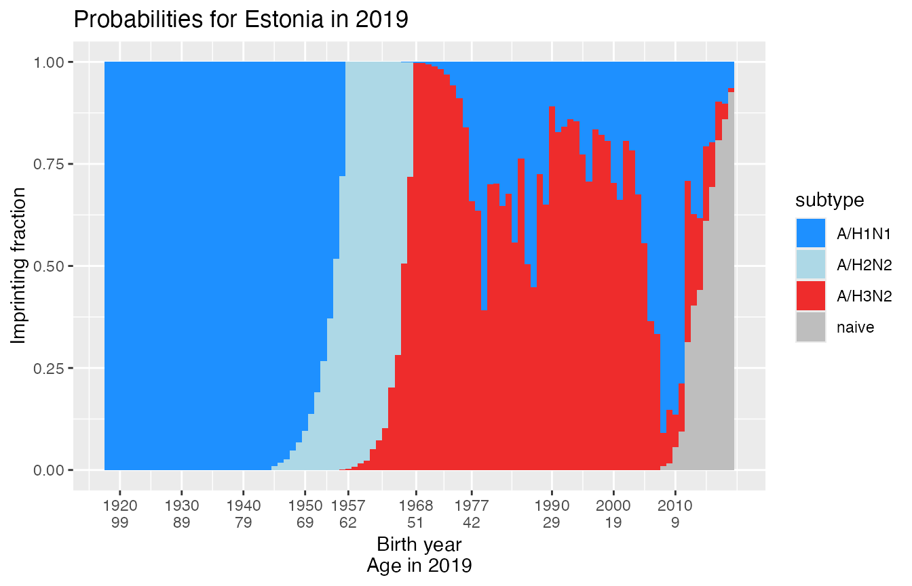
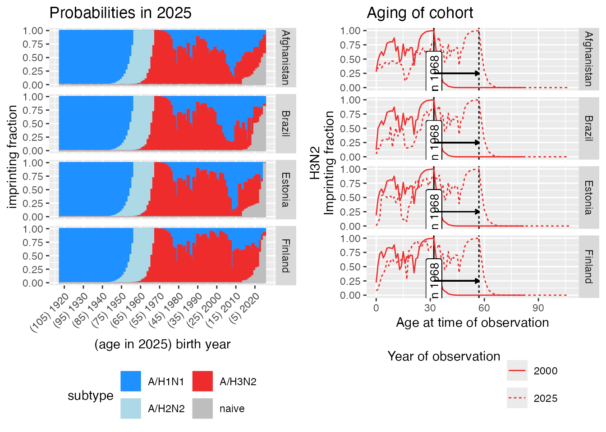

# intro-to-imprinting

## 1. Install the imprinting package

The `imprinting` package isn’t yet available on
[CRAN](https://cran.r-project.org/), so it can’t yet be installed using
the normal `install.packages("imprinting")` command in R. (But this
feature is coming soon!)

For now, we have to install the package from github using the following
steps.

#### 1.1 Install the devtools package

If prompted: you do not need to researt R prior to lading, and you do
not need to install from souce.

[`install.packages`](https://rdrr.io/r/utils/install.packages.html)`(``"devtools"``, repos``=``'http://cran.us.r-project.org'``)`

#### 1.2 Load the devtools package

[`library`](https://rdrr.io/r/base/library.html)`(`[`devtools`](https://devtools.r-lib.org/)`)`` ``# Load the package`` ``#> Loading required package: usethis`

Now that we have devtools installed, we can use the
[`install_github()`](https://devtools.r-lib.org/reference/install-deprecated.html)
function to install the imprinting package.

#### 1.3 Install the imprinting package from github

This builds and installs the package using source files from
<https://github.com/cobeylab/imprinting>.

`devtools``::`[`install_github`](https://devtools.r-lib.org/reference/install-deprecated.html)`(``"cobeylab/imprinting"``)`` `

#### 1.4 Load the imprinting package

[`library`](https://rdrr.io/r/base/library.html)`(`[`imprinting`](https://cobeylab.github.io/imprinting/)`)`` `

Now the package should be installed and loaded into your R workspace.

## 2. Use the package to calculate imprinting probabilities

The main reason to use the `imprinting` package is to calculate birth
year-specific probabilities of imprinting to a specific subtype of
influenza A. You can read more about the biology and methods behind
these calculations in [Gostic et
al. (2016)](https://doi.org/10.1126/science.aag1322).

### 2.1 Calculate imprinting probabilities for one country and year of observation

Use the function
[`get_imprinting_probabilities()`](https://cobeylab.github.io/imprinting/reference/get_imprinting_probabilities.md).
Run
[`?get_imprinting_probabilities`](https://cobeylab.github.io/imprinting/reference/get_imprinting_probabilities.md)
for help.

[`get_imprinting_probabilities`](https://cobeylab.github.io/imprinting/reference/get_imprinting_probabilities.md)`(``observation_years ``=`` ``2025``, countries ``=`` ``"United States"``)`` ``#> ``# A tibble: 432 × 5`` ``#> year country birth_year subtype imprinting_prob`` ``#> ``<dbl>`` ``<chr>`` ``<dbl>`` ``<chr>`` ``<dbl>`` ``#> `` 1`` ``2``025 United States ``2``025 A/H1N1 0.068``8`` ``#> `` 2`` ``2``025 United States ``2``024 A/H1N1 0.092``4`` ``#> `` 3`` ``2``025 United States ``2``023 A/H1N1 0.109 `` ``#> `` 4`` ``2``025 United States ``2``022 A/H1N1 0.110 `` ``#> `` 5`` ``2``025 United States ``2``021 A/H1N1 0.109 `` ``#> `` 6`` ``2``025 United States ``2``020 A/H1N1 0.176 `` ``#> `` 7`` ``2``025 United States ``2``019 A/H1N1 0.245 `` ``#> `` 8`` ``2``025 United States ``2``018 A/H1N1 0.252 `` ``#> `` 9`` ``2``025 United States ``2``017 A/H1N1 0.209 `` ``#> ``10`` ``2``025 United States ``2``016 A/H1N1 0.282 `` ``#> ``# ℹ 422 more rows`

The function returns a tibble wtih five columns: `subtype`, `year`,
`country`, `birth_year`, and `imprinting_prob`. The column
`imprinting_prob` gives the probability that someone born in
`birth_year` and observed in `year` has imprinted to `subtype`.

We can run the same command use the `df_format='wide'` option to output
the same results in wide format. This displays all imprinting
probabilities for the cohort side-by-side

[`get_imprinting_probabilities`](https://cobeylab.github.io/imprinting/reference/get_imprinting_probabilities.md)`(``observation_years ``=`` ``2025``, `` `` countries ``=`` ``"United States"``, `` `` df_format ``=`` ``'wide'``)`` ``#> ``# A tibble: 108 × 7`` ``` #> year country birth_year `A/H1N1` `A/H2N2` `A/H3N2` naive ``` ``#> ``<dbl>`` ``<chr>`` ``<dbl>`` ``<dbl>`` ``<dbl>`` ``<dbl>`` ``<dbl>`` ``#> `` 1`` ``2``025 United States ``1``918 1 0 0 2.22``e``-16`` ``#> `` 2`` ``2``025 United States ``1``919 1 0 0 0 `` `` `` ``#> `` 3`` ``2``025 United States ``1``920 1 0 0 1.11``e``-16`` ``#> `` 4`` ``2``025 United States ``1``921 1 0 0 2.22``e``-16`` ``#> `` 5`` ``2``025 United States ``1``922 1 0 0 2.22``e``-16`` ``#> `` 6`` ``2``025 United States ``1``923 1 0 0 -``2.22``e``-16`` ``#> `` 7`` ``2``025 United States ``1``924 1 0 0 0 `` `` `` ``#> `` 8`` ``2``025 United States ``1``925 1 0 0 0 `` `` `` ``#> `` 9`` ``2``025 United States ``1``926 1 0 0 0 `` `` `` ``#> ``10`` ``2``025 United States ``1``927 1 0 0 1.11``e``-16`` ``#> ``# ℹ 98 more rows`

### 2.2 Why do we specify the `observation_year`?

The `observation_year` affects imprinting probabilities in birth cohorts
who are young enough to still be in the process of imprinting. Our model
assumes that everyone has been infected by influenza before age 12, so
in cohorts \<12 years of age at the time of observation, imprinting
probabilities depend on the observation year.

E.g. consider the cohort born in 2000:

- If the observation year is 2005, then this birth cohort is five years
  old, and still young enough to remain naive to influenza. The outputs
  below show that 22.9% of the cohort has not yet imprinted to any
  subtype.
- If we calculate imprinting probabilities for the same birth cohort
  observed in 2011 (at age 11), the model shows that most of the cohort
  has imprinted, but there is still a very small non-zero probability of
  remaining naive.
- When the cohort reaches age 12, (observation year 2012) the model
  enforces the assumption that everyone in the cohort has imprinted. It
  normalizes the probabilities of subtype-specific imprinting so that
  the H1N1, H2N2, and H3N2-specific probabilities sum to 1, and it sets
  the naive probability to zero.
- Once the cohort reaches age 12, imprinting probabilities are fixed.
  The outputs below show that imprinting probabilities for the 2000
  cohort are identical if observed at age 12 (in 2012), or at age 25 (in
  2025).

Note: we added the age_at_observation column to the outputs below for
clarity.

[`get_imprinting_probabilities`](https://cobeylab.github.io/imprinting/reference/get_imprinting_probabilities.md)`(``observation_years ``=`` `[`c`](https://rdrr.io/r/base/c.html)`(``2005``, ``2011``, ``2012``, ``2025``)``, `` `` countries ``=`` ``"United States"``, `` `` df_format ``=`` ``'wide'``)`` ``%>%`` `` ``dplyr``::`[`filter`](https://dplyr.tidyverse.org/reference/filter.html)`(``birth_year`` ``==`` ``2000``)`` ``%>%`` `` ``mutate``(``age_at_observation ``=`` ``year``-``birth_year``)`` ``%>%`` `` ``select``(`[`c`](https://rdrr.io/r/base/c.html)`(``1``,``2``,``3``,``8``,``4``:``7``)``)`` ``#> ``# A tibble: 4 × 8`` ``` #> year country birth_year age_at_observation `A/H1N1` `A/H2N2` `A/H3N2` naive ``` ``#> ``<dbl>`` ``<chr>`` ``<dbl>`` ``<dbl>`` ``<dbl>`` ``<dbl>`` ``<dbl>`` ``<dbl>`` ``#> ``1`` ``2``005 United… ``2``000 5 0.208 0 0.594 0.198 `` ``#> ``2`` ``2``011 United… ``2``000 11 0.314 0 0.679 0.007``16`` ``#> ``3`` ``2``012 United… ``2``000 12 0.316 0 0.684 0 `` ``#> ``4`` ``2``025 United… ``2``000 25 0.316 0 0.684 0`

### 2.2 View a list of the available countries

We can only calculate imprinting probabilities for countries with data
in [WHO Flu Net](https://www.who.int/tools/flunet). The input name and
spelling must match the outputs below:

[`show_available_countries`](https://cobeylab.github.io/imprinting/reference/show_available_countries.md)`(``)`` ``%>%`` `` `[`print`](https://rdrr.io/r/base/print.html)`(``n ``=`` ``200``)`` ``#> ``# A tibble: 175 × 1`` ``#> country `` ``#> ``<chr>`` `` ``#> `` 1`` Afghanistan `` ``#> `` 2`` Albania `` ``#> `` 3`` Algeria `` ``#> `` 4`` Angola `` ``#> `` 5`` Anguilla `` ``#> `` 6`` Antigua and Barbuda `` ``#> `` 7`` Argentina `` ``#> `` 8`` Armenia `` ``#> `` 9`` Aruba `` ``#> `` 10`` Australia `` ``#> `` 11`` Austria `` ``#> `` 12`` Azerbaijan `` ``#> `` 13`` Bahamas `` ``#> `` 14`` Bahrain `` ``#> `` 15`` Bangladesh `` ``#> `` 16`` Barbados `` ``#> `` 17`` Belarus `` ``#> `` 18`` Belgium `` ``#> `` 19`` Belize `` ``#> `` 20`` Bermuda `` ``#> `` 21`` Bhutan `` ``#> `` 22`` Bolivia `` ``#> `` 23`` Bosnia and Herzegovina `` ``#> `` 24`` Brazil `` ``#> `` 25`` British Virgin Islands `` ``#> `` 26`` Bulgaria `` ``#> `` 27`` Burkina Faso `` ``#> `` 28`` Cabo Verde `` ``#> `` 29`` Cambodia `` ``#> `` 30`` Cameroon `` ``#> `` 31`` Canada `` ``#> `` 32`` Cayman Islands `` ``#> `` 33`` Central African Republic `` ``#> `` 34`` Chad `` ``#> `` 35`` Chile `` ``#> `` 36`` China `` ``#> `` 37`` Colombia `` ``#> `` 38`` Congo `` ``#> `` 39`` Costa Rica `` ``#> `` 40`` Cote d'Ivoire `` ``#> `` 41`` Croatia `` ``#> `` 42`` Cuba `` ``#> `` 43`` Cyprus `` ``#> `` 44`` Czechia `` ``#> `` 45`` Democratic Republic of Congo `` ``#> `` 46`` Denmark `` ``#> `` 47`` Dominica `` ``#> `` 48`` Dominican Republic `` ``#> `` 49`` Ecuador `` ``#> `` 50`` Egypt `` ``#> `` 51`` El Salvador `` ``#> `` 52`` Estonia `` ``#> `` 53`` Ethiopia `` ``#> `` 54`` Fiji `` ``#> `` 55`` Finland `` ``#> `` 56`` France `` ``#> `` 57`` French Guiana `` ``#> `` 58`` Gambia `` ``#> `` 59`` Georgia `` ``#> `` 60`` Germany `` ``#> `` 61`` Ghana `` ``#> `` 62`` Greece `` ``#> `` 63`` Grenada `` ``#> `` 64`` Guadeloupe `` ``#> `` 65`` Guatemala `` ``#> `` 66`` Guinea `` ``#> `` 67`` Guinea-Bissau `` ``#> `` 68`` Guyana `` ``#> `` 69`` Haiti `` ``#> `` 70`` Honduras `` ``#> `` 71`` Hungary `` ``#> `` 72`` Iceland `` ``#> `` 73`` India `` ``#> `` 74`` Indonesia `` ``#> `` 75`` Iran `` ``#> `` 76`` Iraq `` ``#> `` 77`` Ireland `` ``#> `` 78`` Israel `` ``#> `` 79`` Italy `` ``#> `` 80`` Jamaica `` ``#> `` 81`` Japan `` ``#> `` 82`` Jordan `` ``#> `` 83`` Kazakhstan `` ``#> `` 84`` Kenya `` ``#> `` 85`` Kosovo `` ``#> `` 86`` Kuwait `` ``#> `` 87`` Kyrgyzstan `` ``#> `` 88`` Laos `` ``#> `` 89`` Latvia `` ``#> `` 90`` Lebanon `` ``#> `` 91`` Lithuania `` ``#> `` 92`` Luxembourg `` ``#> `` 93`` Madagascar `` ``#> `` 94`` Malaysia `` ``#> `` 95`` Maldives `` ``#> `` 96`` Mali `` ``#> `` 97`` Malta `` ``#> `` 98`` Martinique `` ``#> `` 99`` Mauritania `` ``#> ``100`` Mauritius `` ``#> ``101`` Mexico `` ``#> ``102`` Moldova `` ``#> ``103`` Mongolia `` ``#> ``104`` Montenegro `` ``#> ``105`` Morocco `` ``#> ``106`` Mozambique `` ``#> ``107`` Myanmar `` ``#> ``108`` Namibia `` ``#> ``109`` Nepal `` ``#> ``110`` Netherlands `` ``#> ``111`` New Caledonia `` ``#> ``112`` New Zealand `` ``#> ``113`` Nicaragua `` ``#> ``114`` Niger `` ``#> ``115`` Nigeria `` ``#> ``116`` North Korea `` ``#> ``117`` North Macedonia `` ``#> ``118`` Norway `` ``#> ``119`` Oman `` ``#> ``120`` Pakistan `` ``#> ``121`` Palestine `` ``#> ``122`` Panama `` ``#> ``123`` Papua New Guinea `` ``#> ``124`` Paraguay `` ``#> ``125`` Peru `` ``#> ``126`` Philippines `` ``#> ``127`` Poland `` ``#> ``128`` Portugal `` ``#> ``129`` Qatar `` ``#> ``130`` Romania `` ``#> ``131`` Russia `` ``#> ``132`` Rwanda `` ``#> ``133`` Saint Kitts and Nevis `` ``#> ``134`` Saint Lucia `` ``#> ``135`` Saint Vincent and the Grenadines`` ``#> ``136`` Saudi Arabia `` ``#> ``137`` Senegal `` ``#> ``138`` Serbia `` ``#> ``139`` Seychelles `` ``#> ``140`` Sierra Leone `` ``#> ``141`` Singapore `` ``#> ``142`` Slovakia `` ``#> ``143`` Slovenia `` ``#> ``144`` South Africa `` ``#> ``145`` South Korea `` ``#> ``146`` South Sudan `` ``#> ``147`` Spain `` ``#> ``148`` Sri Lanka `` ``#> ``149`` Sudan `` ``#> ``150`` Suriname `` ``#> ``151`` Sweden `` ``#> ``152`` Switzerland `` ``#> ``153`` Syria `` ``#> ``154`` Tajikistan `` ``#> ``155`` Tanzania `` ``#> ``156`` Thailand `` ``#> ``157`` Timor `` ``#> ``158`` Togo `` ``#> ``159`` Trinidad and Tobago `` ``#> ``160`` Tunisia `` ``#> ``161`` Turkey `` ``#> ``162`` Turkmenistan `` ``#> ``163`` Turks and Caicos `` ``#> ``164`` Uganda `` ``#> ``165`` Ukraine `` ``#> ``166`` United Arab Emirates `` ``#> ``167`` United Kingdom `` ``#> ``168`` United States `` ``#> ``169`` Uruguay `` ``#> ``170`` Uzbekistan `` ``#> ``171`` Venezuela `` ``#> ``172`` Vietnam `` ``#> ``173`` Yemen `` ``#> ``174`` Zambia `` ``#> ``175`` Zimbabwe`

### 2.3 Generate probabilities for many countries and observation years

`many_probabilities`` ``=`` `[`get_imprinting_probabilities`](https://cobeylab.github.io/imprinting/reference/get_imprinting_probabilities.md)`(``observation_years ``=`` `[`c`](https://rdrr.io/r/base/c.html)`(``2000``, ``2019``, ``2025``)``,`` `` countries ``=`` `[`c`](https://rdrr.io/r/base/c.html)`(``'Brazil'``, ``'Afghanistan'``, ``'Estonia'``, ``'Finland'``)``)`` `` ``## Store the outputs in a variable called many_probabilities`` ``many_probabilities`` ``## View the outputs in the console`` ``#> ``# A tibble: 4,688 × 5`` ``#> year country birth_year subtype imprinting_prob`` ``#> ``<dbl>`` ``<chr>`` ``<dbl>`` ``<chr>`` ``<dbl>`` ``#> `` 1`` ``2``025 Brazil ``2``025 A/H1N1 0.139 `` ``#> `` 2`` ``2``025 Afghanistan ``2``025 A/H1N1 0.084``0`` ``#> `` 3`` ``2``025 Estonia ``2``025 A/H1N1 0.010``6`` ``#> `` 4`` ``2``025 Finland ``2``025 A/H1N1 0.065``7`` ``#> `` 5`` ``2``025 Brazil ``2``024 A/H1N1 0.196 `` ``#> `` 6`` ``2``025 Afghanistan ``2``024 A/H1N1 0.167 `` ``#> `` 7`` ``2``025 Estonia ``2``024 A/H1N1 0.305 `` ``#> `` 8`` ``2``025 Finland ``2``024 A/H1N1 0.115 `` ``#> `` 9`` ``2``025 Brazil ``2``023 A/H1N1 0.239 `` ``#> ``10`` ``2``025 Afghanistan ``2``023 A/H1N1 0.198 `` ``#> ``# ℹ 4,678 more rows`

Alternatively, you can view the outputs in a separate window or save
them as a .csv file on your hard drive.

`# View the outputs in a separate window.`` `[`View`](https://rdrr.io/r/utils/View.html)`(``many_probabilities``)`` `` `` ``# Save the outputs as a .csv file in your current working directory.`` ``write_csv``(``many_probabilities``, ``'many_probabilities.csv'``)`` `

## 3. Plot the outputs

### 3.1 Plot the first country-year combination in the output data frame

[`plot_one_country_year()`](https://cobeylab.github.io/imprinting/reference/plot_one_country_year.md)
takes a long-formatted output data frame and plots the first country and
year combination.

[`head`](https://rdrr.io/r/utils/head.html)`(``many_probabilities``)`` ``#> ``# A tibble: 6 × 5`` ``#> year country birth_year subtype imprinting_prob`` ``#> ``<dbl>`` ``<chr>`` ``<dbl>`` ``<chr>`` ``<dbl>`` ``#> ``1`` ``2``025 Brazil ``2``025 A/H1N1 0.139 `` ``#> ``2`` ``2``025 Afghanistan ``2``025 A/H1N1 0.084``0`` ``#> ``3`` ``2``025 Estonia ``2``025 A/H1N1 0.010``6`` ``#> ``4`` ``2``025 Finland ``2``025 A/H1N1 0.065``7`` ``#> ``5`` ``2``025 Brazil ``2``024 A/H1N1 0.196 `` ``#> ``6`` ``2``025 Afghanistan ``2``024 A/H1N1 0.167`` `[`plot_one_country_year`](https://cobeylab.github.io/imprinting/reference/plot_one_country_year.md)`(``many_probabilities``)`` `



### Select a specific country and year to plot

You can use [`filter()`](https://rdrr.io/r/stats/filter.html) to select
a specific country and year for plotting.

[`plot_one_country_year`](https://cobeylab.github.io/imprinting/reference/plot_one_country_year.md)`(``many_probabilities`` ``%>%`` `` `` ``dplyr``::`[`filter`](https://dplyr.tidyverse.org/reference/filter.html)`(``country`` ``==`` ``'Estonia'``, ``year`` ``==`` ``2019``)``)`



### 3.2 Plot up to five countires at a time

[`plot_many_country_years()`](https://cobeylab.github.io/imprinting/reference/plot_many_country_years.md)
generates a plot of the first five countries in the imprinting outputs,
across an arbitrary number of years.

- The plots on the left show imprinting probabilities for the latest
  observation year
- The plots on the right show how H3N2 imprinting probabilities have
  changed as cohorts grow older from the earliest to the latest
  observation year in the outputs. The vertical lines and arrow show
  aging of the 1968 birth cohort.

[`plot_many_country_years`](https://cobeylab.github.io/imprinting/reference/plot_many_country_years.md)`(``many_probabilities``)`` ``#> Warning in geom_label(aes(x = min_obs_year - 1968, y = 0.1, label = "born 1968"), : All aesthetics have length 1, but the data has 764 rows.`` ``#> ``ℹ```  Please consider using `annotate()` or provide this layer with data containing ``` ``#> a single row.`` ``#> Warning in geom_segment(aes(x = min_obs_year - 1968, xend = max_obs_year - : All aesthetics have length 1, but the data has 764 rows.`` ``#> ``ℹ```  Please consider using `annotate()` or provide this layer with data containing ``` ``#> a single row.`



## 4. Explore the underlying data and components of the imprinting probabilities

Get the fraction of influenza circulation caused by each subtype in each
epidemic year from 1918-2025 in the United States using
`get_country_cocirculation`. Run
[`?get_country_cocirculation_data`](https://cobeylab.github.io/imprinting/reference/get_country_cocirculation_data.md)
for notes on data sources.

[`get_country_cocirculation_data`](https://cobeylab.github.io/imprinting/reference/get_country_cocirculation_data.md)`(``'United States'``, ``2025``)`` ``#> ``# A tibble: 108 × 9`` ``` #> year `A/H1N1` `A/H2N2` `A/H3N2` A B group1 group2 data_from  ``` ``#> ``<dbl>`` ``<dbl>`` ``<dbl>`` ``<dbl>`` ``<dbl>`` ``<lgl>`` ``<dbl>`` ``<dbl>`` ``<chr>`` `` ``#> `` 1`` ``1``918 1 0 0 1 ``NA`` 1 0 Historical_assump…`` ``#> `` 2`` ``1``919 1 0 0 1 ``NA`` 1 0 Historical_assump…`` ``#> `` 3`` ``1``920 1 0 0 1 ``NA`` 1 0 Historical_assump…`` ``#> `` 4`` ``1``921 1 0 0 1 ``NA`` 1 0 Historical_assump…`` ``#> `` 5`` ``1``922 1 0 0 1 ``NA`` 1 0 Historical_assump…`` ``#> `` 6`` ``1``923 1 0 0 1 ``NA`` 1 0 Historical_assump…`` ``#> `` 7`` ``1``924 1 0 0 1 ``NA`` 1 0 Historical_assump…`` ``#> `` 8`` ``1``925 1 0 0 1 ``NA`` 1 0 Historical_assump…`` ``#> `` 9`` ``1``926 1 0 0 1 ``NA`` 1 0 Historical_assump…`` ``#> ``10`` ``1``927 1 0 0 1 ``NA`` 1 0 Historical_assump…`` ``#> ``# ℹ 98 more rows`

Get the circulation intensity of influenza A in each epidemic year using
[`get_country_intensity_data()`](https://cobeylab.github.io/imprinting/reference/get_country_intensity_data.md).

- Intensity of 1 is average. Higher values indicate more influenza A
  circulation, lower values indicate less circulation.

See
[`?get_country_intensity_data`](https://cobeylab.github.io/imprinting/reference/get_country_intensity_data.md)
for details on underlying data.

[`get_country_intensity_data`](https://cobeylab.github.io/imprinting/reference/get_country_intensity_data.md)`(``country ``=`` ``'China'``, max_year ``=`` ``2025``)`` ``#> ``# A tibble: 116 × 2`` ``#> year intensity`` ``#> ``<dbl>`` ``<dbl>`` ``#> `` 1`` ``1``911 1 `` ``#> `` 2`` ``1``912 1 `` ``#> `` 3`` ``1``913 1 `` ``#> `` 4`` ``1``914 1 `` ``#> `` 5`` ``1``915 1.12`` ``#> `` 6`` ``1``916 1.29`` ``#> `` 7`` ``1``917 1.23`` ``#> `` 8`` ``1``918 2.5 `` ``#> `` 9`` ``1``919 2.5 `` ``#> ``10`` ``1``920 1.87`` ``#> ``# ℹ 106 more rows`

### Get the probability that an individual imprinted 0, 1, 2, … 12 years after birth

Use the function
[`get_p_infection_year()`](https://cobeylab.github.io/imprinting/reference/get_p_infection_year.md)

`probs`` ``=`` `[`get_p_infection_year`](https://cobeylab.github.io/imprinting/reference/get_p_infection_year.md)`(``birth_year ``=`` ``2000``,`` `` observation_year ``=`` ``2025``,`` `` intensity_df ``=`` `[`get_country_intensity_data`](https://cobeylab.github.io/imprinting/reference/get_country_intensity_data.md)`(``'Mexico'``, ``2025``)``,`` `` max_year ``=`` ``2025``)`` `[`names`](https://rdrr.io/r/base/names.html)`(``probs``)`` ``=`` `[`as.character`](https://rdrr.io/r/base/character.html)`(``2000``+``(``0``:``12``)``)`` ``probs`` ``#> 2000 2001 2002 2003 2004 2005 `` ``#> 0.013797773 0.035794301 0.013418839 0.073795467 0.014636353 0.088648870 `` ``#> 2006 2007 2008 2009 2010 2011 `` ``#> 0.007305318 0.055459469 0.016887660 0.476179165 0.114326388 0.014541404 `` ``#> 2012 `` ``#> 0.039015266`` `[`sum`](https://rdrr.io/r/base/sum.html)`(``probs``)`` ``## Raw probabilities are not yet normalized.`` ``#> [1] 0.9638063`` `` ``norm_probs`` ``=`` ``probs``/`[`sum`](https://rdrr.io/r/base/sum.html)`(``probs``)`` ``## Normalize`` `[`sum`](https://rdrr.io/r/base/sum.html)`(``norm_probs``)`` ``#> [1] 1`
